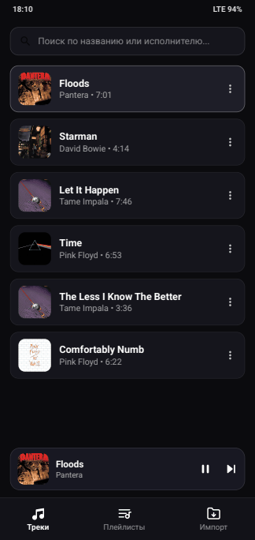
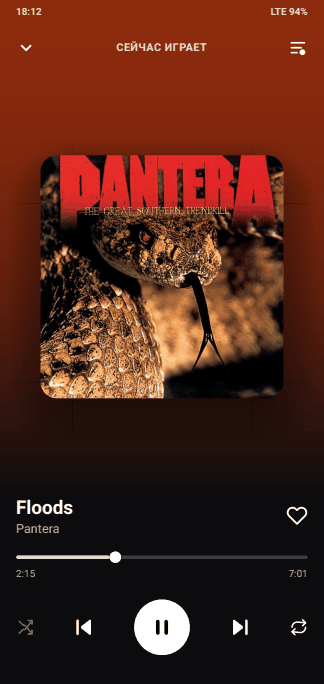
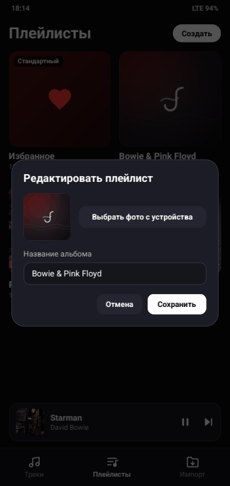

<div align="center">


# Music Player

**Автономный музыкальный плеер для Android на .NET MAUI с извлечением обложек из метаданных, очередью воспроизведения и локальной базой плейлистов**

[Возможности](#возможности) · [Демонстрация](#демонстрация) · [Архитектура](#архитектура-и-стек)

</div>

Music Player сканирует память смартфона, достаёт теги и оригинальные обложки из аудиофайлов, сохраняет подборки в SQLite и продолжает играть в фоне без интернета и рекламы.

## Демонстрация

<table align="center">
<tr>
<td align="center" width="33%">

<br />
<sub><b>Треки и поиск</b><br />Обложки из тегов, поиск и шторка действий</sub>
</td>
<td align="center" width="33%">

<br />
<sub><b>Полноэкранный плеер</b><br />Динамический градиент и управление</sub>
</td>
<td align="center" width="33%">

<br />
<sub><b>Плейлисты и импорт</b><br />Подборки в SQLite и MediaStore</sub>
</td>
</tr>
</table>

## Возможности

* **Обложки из метаданных и ручная загрузка.** Библиотека `TagLibSharp` и сервис `AndroidTrackCoverExtractor` вытаскивают встроенные обложки альбомов, название, исполнителя и длительность в форматах `MP3`, `FLAC`, `WAV`, `M4A`, `AAC`, `OGG` и `Opus`. Если в файле нет картинки, для плейлиста можно выбрать обложку вручную из галереи устройства.

* **Динамический градиент экрана.** Полноэкранный плеер считывает доминирующий цвет текущей обложки (по умолчанию `#7C1919`) и плавно переводит его в тёмный фон `#0B0B0E`.

* **Импорт без копирования на диск.** Сканер `AndroidMediaStoreAudioScanner` индексирует музыку через системный каталог `MediaStore`, не дублируя файлы во внутреннее хранилище.

* **Живой поиск и шторка действий.** Фильтруйте фонотеку по названию и исполнителю по мере ввода текста. Меню по кнопке с тремя точками ставит трек следующим в очередь (`Enqueue`), добавляет в плейлист или убирает из библиотеки.

* **Правило 4 секунд на кнопке «Назад».** Если композиция играет 5 секунд или дольше, нажатие возвращает её к `0:00`. Если прошло 4 секунды или меньше, включается предыдущий трек в очереди.

* **Стабильная перемотка.** После перетаскивания ползунка действует окно стабилизации `300 мс` (`SeekStabilizationMs`), поэтому позиция не прыгает назад из-за задержки нативного `MediaPlayer`.

* **Фоновое воспроизведение.** Сервис `MediaPlaybackForegroundService` и `AndroidMediaNotificationService` выводят обложку и кнопки управления в шторку уведомлений.

## Архитектура и стек

Решение разделяет чистую доменную логику и слой интерфейса Android:

* **`.NET 11 / .NET MAUI`** (`net11.0-android`, поддержка Android 10 / API 29+)

* **`CommunityToolkit.Mvvm` (8.4.2)** генерация команд и свойств ViewModel

* **`CommunityToolkit.Maui` (17.0.0)** тактильный отклик `TouchBehavior` и перекраска SVG `IconTintColorBehavior`

* **`sqlite-net-pcl` (1.11.285)** асинхронное хранение таблиц `PlaylistEntity`, `PlaylistTrackEntity` и `TrackCacheEntity`

* **`TagLibSharp` (2.3.0)** разбор тегов ID3/Vorbis и извлечение обложек альбомов

<details>
<summary><b>Структура решения MusicPlayer.slnx</b></summary>

```
MusicPlayer.slnx
├── Directory.Packages.props
├── docs/
│   └── assets/                           # Логотип и GIF-демонстрации для README
└── src/
    ├── MusicPlayer.Core/                 # Доменные модели и функциональные примитивы
    │   ├── AudioTracks/                  # AudioTrack, AudioFormat, MimeTypeParser
    │   ├── Playlists/                    # Playlist (защита «Избранного», лимит 100 символов)
    │   └── Primitives/                   # Result<T>, Option<T>, Error, BatchObservableCollection
    └── MusicPlayer/                      # Клиентское приложение .NET MAUI (Android)
        ├── Features/
        │   ├── Importer/                 # ImportPage, AndroidMediaStoreAudioScanner, TrackStorage
        │   ├── Player/                   # PlayerPage, MiniPlayerView, PlayerQueueSheet, анимации
        │   ├── Playlists/                # PlaylistsPage, PlaylistDetailPage, SqlitePlaylistRepository
        │   └── Tracks/                   # TracksPage, TrackOptionsBottomSheet, поиск
        ├── Playback/                     # AndroidAudioPlayer, PlaybackQueue, CoverExtractor
        ├── Platforms/Android/            # MediaPlaybackForegroundService, MainActivity
        └── Resources/                    # Шрифты Roboto, SVG-иконки, цвета Colors.xaml

```

</details>
